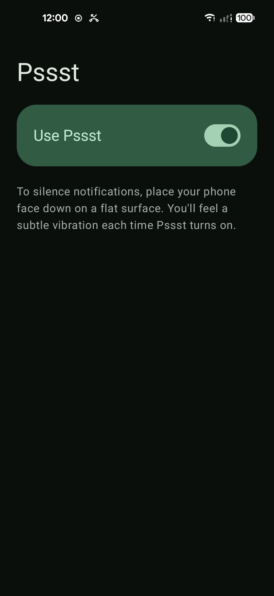
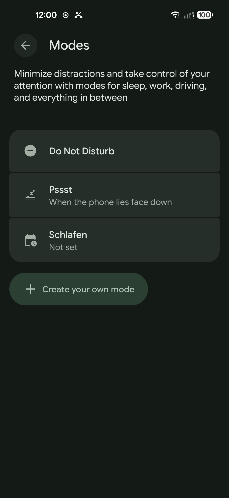

# Pssst


Flip your phone face down to turn on Do Not Disturb, pick it up to turn it off again.
Pssst brings the "Flip to Shhh" gesture of Pixel phones to any Android phone, including custom ROMs
without Google services (LineageOS, microG, …).

One switch. No settings, no internet permission, no tracking.

<p>
  
  &nbsp;
  
</p>

## Behavior

Pssst copies the original as closely as a normal (non-system) app can:

- **Turns on** when the phone lies face down, flat and still for 1 s
- **Turns off** when the phone is picked up or turned over
- **Feedback:** three fading taps when Do Not Disturb turns on, one short tick 100 ms after it turns off
- **Own Do Not Disturb rule** in Priority mode. Your exceptions (starred contacts, alarms, repeat callers) keep working,
  and Do Not Disturb you turned on yourself is never touched. The rule appears in the system Do Not Disturb settings.
- **First flip:** a one-time notification explains what happened and links to the Do Not Disturb settings

### Detection

| Parameter | Value |
|---|---|
| Accelerometer sampling | 100 ms |
| Low-pass averaging rate | 0.4 per sample |
| Max angle from lying flat face down | 0.1 rad (≈ 5.7°) |
| Max acceleration magnitude deviation from 1 g | 5.0 m/s² |
| Stillness limit (screen on / screen off with proximity) | 0.065 / 0.15 m/s² |
| Minimum face-down time | 1.0 s |
| Gravity change that ends a session | 3.0 m/s² |
| Trigger quota | 30, refilling 0.04 per second |

The values follow the defaults of the Flip to Shhh configuration found in Google Play Services. Some units
(radians vs. degrees) are interpretations confirmed by testing on a device.

### Screen off and battery

Most phones have no wake-up accelerometer, so the accelerometer cannot wake the CPU while the screen is off.
Pssst therefore:

1. keeps the accelerometer running for 5 s after the screen turns off (covers "press power, then flip"),
2. then lets the wake-up **proximity sensor** watch: covered → up to 4 s accelerometer check for face down,
   uncovered while flipped → 2 s check for picked up.

A covered check ends after 0.5 s when the phone is clearly not lying flat (tilted more than 0.5 rad, e.g. in a pocket),
so walking around with the phone in a pocket costs very little.

For reliable checks in deep sleep, Pssst asks to be excluded from battery optimization.

### Differences from the Pixel original

The Pixel feature runs inside Google Play Services and a sensor-hub nanoapp with system privileges. A normal app cannot:

- silence a call that is already ringing (`TelecomManager.silenceRinger` needs a system permission),
- bypass the interruption policy for its vibration (Pssst uses alarm vibration instead, which also works in silent mode),
- run without an ongoing notification (Android requires one for the background sensor service).

## Permissions

| Permission | Why |
|---|---|
| Do Not Disturb access | switch the Pssst rule |
| Foreground service (special use) | watch the sensors in the background |
| Ignore battery optimization | screen-off checks in deep sleep |
| Notifications | first-flip tip and the required ongoing notification |
| Run at startup | restart after reboot when enabled |
| Vibrate, wake lock | feedback and short sensor checks |

No internet permission. Nothing leaves the device.

## Requirements

- Android 10+ (API 29)
- Accelerometer, proximity sensor recommended
- **No** Pixel hardware, root or Google services needed. Pssst uses the standard Android sensor APIs,
  not the Pixel sensor-hub nanoapp, so it runs on any phone

## Build

```bash
./gradlew assembleDebug        # build
./gradlew testDebugUnitTest    # JVM unit tests
./gradlew deploy               # install + launch on a connected device
```

Debug logging of angle and stillness values:

```bash
adb shell setprop log.tag.Pssst DEBUG
adb logcat -s Pssst
```

## Releasing

1. Bump `versionCode` and `versionName` in `app/build.gradle`
2. Add `fastlane/metadata/android/en-US/changelogs/<versionCode>.txt` (and `de-DE`)
3. Commit, tag `v<versionName>` and push the tag. The Release workflow builds a signed APK and publishes a GitHub release.

The workflow needs these repository secrets: `KEYSTORE_BASE64`, `KEYSTORE_PASSWORD`, `KEY_ALIAS`, `KEY_PASSWORD`.
Without a keystore the release build is unsigned, which is what F-Droid expects since it signs its own builds.

Store listing assets live in the Fastlane layout under [`fastlane/metadata/android`](fastlane/metadata/android),
which F-Droid reads automatically. A draft F-Droid metadata file for submission to
[fdroiddata](https://gitlab.com/fdroid/fdroiddata) is in [`docs/fdroid/com.herrderb.pssst.yml`](docs/fdroid/com.herrderb.pssst.yml).

## License

Pssst is free software under the [GNU General Public License v3.0 or later](LICENSE).
You may use, study, change and share it, as long as changed versions stay open source under the same license.

Pssst is not affiliated with or endorsed by Google. Pixel is a trademark of Google LLC.
